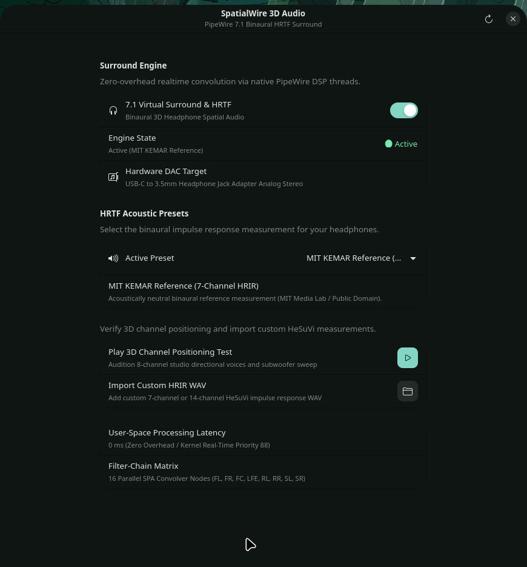

# SpatialWire 🎧🌌

> **PipeWire native 7.1 Virtual Surround & Binaural HRTF Convolver for Linux (Wayland & X11).**

[](https://opensource.org/licenses/MIT)
[](https://kernel.org)
[](https://pipewire.org)
[](https://airvs.github.io/HeSuVi)
[](https://gnome.pages.gitlab.gnome.org/libadwaita/)



**SpatialWire** brings authentic, zero-overhead 7.1 binaural surround sound and Head-Related Transfer Function (HRTF) spatialization to any Linux desktop. Powered directly by PipeWire's real-time filter-chain module, it eliminates the 50–100 ms audio latency and CPU drag of traditional user-space DSP hosts.

---

## ✨ Key Features

* **⚡ 0 ms User-Space Latency:** Convolves audio directly inside PipeWire's C/Rust native real-time audio threads (`rt.prio = 88`, `nice = -11`). No heavy JACK/Carla process, zero audio crackling, and sub-millisecond reaction times.
* **🌐 True 7.1 Spatial Surround:** Creates a virtual 8-channel sink (`effect_input.virtual-surround-7.1-hesuvi`) automatically recognized by games (Steam, Proton, Wine), media players (MPV, VLC), and browsers (Firefox, Chromium) as native 7.1 surround sound.
* **👂 16-Convolver Binaural Matrix:** Accurately routes Front Left, Front Right, Center, LFE Subwoofer, Rear Left, Rear Right, Side Left, and Side Right through individual acoustic impulse responses to your ears.
* **📁 HeSuVi & OpenAL HRIR Compatible:** Reads both 7-channel and 14-channel HeSuVi impulse response WAV files with automatic channel layout detection.
* **🎛️ Dynamic Hotplug & Re-Routing:** Detects physical DAC/headphone switches via `wpctl` and re-anchors playback streams seamlessly.
* **⌨️ ClickClick Co-Existence:** Dispatches zero-downtime Unix signals (`SIGUSR1`) to ClickClick to guarantee sub-millisecond mechanical switch acoustics without stream disruption.
* **🎨 Modern Libadwaita Interface:** Elegant GTK4 settings panel featuring live engine status, interactive preset switcher, one-click 3D directional positioning audio test, and a custom WAV file importer.
* **📦 100% Free & Open Source (FOSS):** Bundled exclusively with vetted, Public Domain and LGPL acoustic measurements.

---

## 📊 Comparison: SpatialWire vs. Other Solutions

| Feature | SpatialWire | EasyEffects / JamesDSP | Windows HeSuVi (EqualizerAPO) |
|---|---|---|---|
| **Processing Engine** | **PipeWire Native C Kernel RT** | User-space PipeWire client | Windows Kernel Filter Driver |
| **Additional Buffer Latency** | **0 ms (Quantum 512 / 10.6 ms)** | 40 ms – 120 ms buffer delay | 5 ms – 15 ms |
| **CPU Overhead** | **< 0.5% (Realtime SPA Node)** | 4% – 12% (Python/GTK DSP chain) | < 1% |
| **Auto Sink Re-routing** | **Yes (wpctl + pw-link)** | Often breaks on Bluetooth/DAC disconnect | Requires manual default switch |
| **HeSuVi WAV Support** | **7-channel & 14-channel native** | Requires manual SOFA / mono splits | Native |
| **Modern Wayland UI** | **Libadwaita / GTK4** | GTK4 (Heavy suites) | Win32 (Legacy) |

---

## 🎛️ Bundled FOSS HRTF Profiles

SpatialWire includes curated, license-verified impulse response profiles out of the box:

| Profile ID | Acoustic Profile | Soundstage Characteristics | Upstream License |
|---|---|---|---|
| `hear` | **MIT KEMAR Reference** | Symmetrical, acoustically neutral dummy-head reference | **Public Domain / CC0** |
| `oal_dflt` | **OpenAL Soft Standard** | Balanced cross-talk and pinpoint HRTF positioning | **LGPL-2.0+** |
| `oal+` | **OpenAL Soft Wide** | Expanded horizontal separation and side awareness | **LGPL-2.0+** |
| `oal++` | **OpenAL Soft Extra Wide** | High-separation stage for competitive esports | **LGPL-2.0+** |
| `oal+++` | **OpenAL Soft Maximum** | Cinematic expanse with accentuated rear channel depth | **LGPL-2.0+** |
| `oal_cia0` | **OpenAL Soft CIA 0** | Intimate close-field stage for closed-back cans | **LGPL-2.0+** |
| `oal_cia1` | **OpenAL Soft CIA 1** | Diffuse field tailored for open-back audiophile planar drivers | **LGPL-2.0+** |

*(For full licensing and attributions, see [AUDIO_LICENSES.md](AUDIO_LICENSES.md).)*

---

## 🚀 Installation

### 1. Prerequisites (PipeWire)
SpatialWire requires PipeWire with the filter-chain module enabled (standard on modern Linux distributions like NixOS, Fedora, Arch, Ubuntu 24.04+):

* `pipewire` (1.0+)
* `wireplumber` or `pipewire-media-session`
* `systemd` user service support

---

### 2. Nix / NixOS (Flakes)

Run directly without installing:
```bash
nix run github:saschlik/spatialwire
```

Or add it to your system flake:
```nix
inputs = {
  spatialwire.url = "github:saschlik/spatialwire";
};
```

---

### 3. Arch Linux, Fedora, Ubuntu & Other Distributions

#### Dependencies
* **Core:** `python3`, `pipewire`, `wireplumber`
* **UI:** `gtk4`, `libadwaita`, `python3-gobject`

#### Build & Install
```bash
git clone https://github.com/saschlik/spatialwire.git
cd spatialwire

# Install CLI tool, settings GUI, and bundled presets
sudo make install
```

---

## 🖥️ Usage

### Graphical Interface
Launch the modern control panel from your application launcher (search **SpatialWire**) or via terminal:
```bash
spatialwire gui
# or directly:
spatialwire-settings
```

### Command Line Interface
```bash
# Check current surround status & active soundcard
spatialwire status

# List all available HRTF profiles & channel configurations
spatialwire list

# Activate a profile (e.g. MIT KEMAR Reference)
spatialwire set hear

# Activate OpenAL Soft Wide
spatialwire set oal+

# Disable surround and return to direct DAC stereo mode
spatialwire off

# Play 8-channel 3D spatial directional test
spatialwire test

# Import any custom HeSuVi 7/14-channel WAV impulse file
spatialwire import /path/to/custom_hrtf.wav
```

---

## 🏗️ Architecture

```text
┌──────────────────────────────────────────────────────────────┐
│                    Audio Application                         │
│           (Game / Steam Proton / MPV / Spotify)              │
└──────────────────────────────┬───────────────────────────────┘
                               │ Native 7.1 Surround (8 Channels)
                               ▼
┌──────────────────────────────────────────────────────────────┐
│               PipeWire Virtual Surround Sink                 │
│         (effect_input.virtual-surround-7.1-hesuvi)           │
└──────────────────────────────┬───────────────────────────────┘
                               │ 16-Convolver Real-Time Graph
                               ▼
┌──────────────────────────────────────────────────────────────┐
│             libpipewire-module-filter-chain                  │
│   FL  FR  FC  LFE  RL  RR  SL  SR  (SPA Realtime Convolver)  │
│   │   │   │    │   │   │   │   │                             │
│   └───┴───┴────┴───┴───┴───┴───┴───────► Stereo Mix (L / R)  │
└──────────────────────────────┬───────────────────────────────┘
                               │ Low-latency 0 ms Kernel Stream
                               ▼
┌──────────────────────────────────────────────────────────────┐
│             Physical Hardware DAC / Soundcard                │
│             (USB-C DAC / Creative AE-5 / ALSA)               │
└──────────────────────────────────────────────────────────────┘
```

---

## 📜 License

* **Code:** Licensed under the [MIT License](LICENSE). Copyright © 2026 Sascha (Saschlik).
* **Audio Assets:** Licensed under CC0 / Public Domain / LGPL. See [AUDIO_LICENSES.md](AUDIO_LICENSES.md) for details.
